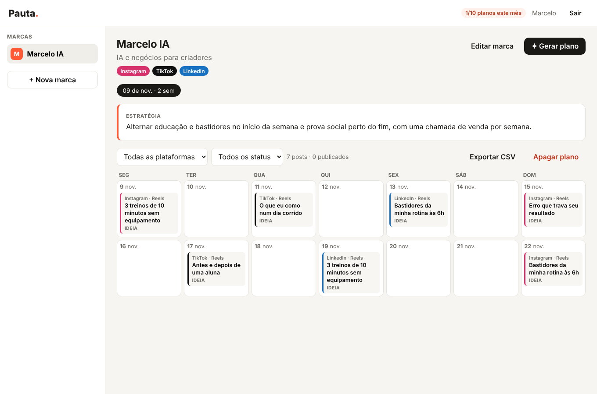

# Pauta: arquitetura do MVP

**Problema:** criadores e pequenas empresas sabem que precisam postar com frequência, mas travam em *o que postar*. Montar um calendário com gancho, roteiro e legenda leva horas por semana.

**Proposta do MVP:** a pessoa descreve a marca uma vez (nicho, público, tom de voz, pilares). Em cerca de 1 minuto, a IA entrega um calendário de 1 a 4 semanas com cada post pronto para gravar ou publicar. Depois a pessoa edita, pede ajustes à IA, marca o que foi publicado e exporta.

**Métrica principal:** quantos planos gerados viram posts marcados como *publicado*. Mede uso real, não só curiosidade.

---

## 1. Arquitetura do sistema

```
 Navegador (SPA em JS puro)
        │  HTTPS + JSON, token JWT no header Authorization
        ▼
 ┌───────────────────────────── FastAPI (pauta.main) ─────────────────────────────┐
 │  rotas/auth.py     rotas/marcas.py     rotas/planos.py (planos + posts)        │
 │        │                 │                    │                                │
 │        └──── deps.py: sessão do banco, usuário logado, checagem de dono ───────│
 │                                               │                                │
 │                       geracao.py (job) ◄──────┘ BackgroundTask                 │
 │                              │                                                 │
 │                          ia.py (Gerador) ──────────► API do Claude             │
 │                                                     (saída estruturada)        │
 └──────────────────────────────┬─────────────────────────────────────────────────┘
                                ▼
                     PostgreSQL (SQLAlchemy 2 + Alembic)
```

**Decisões e por quê:**

| Decisão | Motivo | Quando revisar |
|---|---|---|
| **Monólito modular** (um serviço, módulos separados por domínio) | Um dev, deploy único, menos coisa para quebrar | Quando um módulo precisar escalar sozinho |
| **API sem estado** (JWT, nada em memória) | Dá para rodar N workers e N instâncias atrás de um load balancer sem mudar código | Nunca, é a base para escalar |
| **Geração assíncrona com status no banco** (`pendente → gerando → pronto/erro`) | A chamada à IA leva de 30 s a 2 min, então a API responde `202` na hora e a tela consulta o status | Trocar BackgroundTask por fila (ver §7) sem mudar a API |
| **Saída estruturada da IA** (schema Pydantic) | O código recebe objetos validados, não texto para interpretar. Plataforma e formato são `enum` | — |
| **`Gerador` como protocolo** | Testes rodam sem IA. Trocar de modelo ou provedor mexe num arquivo só | — |
| **SPA sem build** (HTML + JS + CSS servidos pelo FastAPI) | Zero tooling, deploy único, mesma origem (sem CORS) | Quando a interface crescer, migrar para React/Next.js consumindo a mesma API |
| **SQLite local, Postgres em produção** | `uvicorn` roda local sem instalar nada. Os testes passam nos dois | — |

**Segurança:**
- Senhas com scrypt (sal por usuário) e comparação em tempo constante. O login gasta o mesmo tempo para e-mail inexistente, para não revelar quais contas existem.
- JWT HS256 com validade de 7 dias. Em produção a app não sobe sem `SECRET_KEY` de 32+ caracteres.
- **Multi-tenant por dono:** toda rota passa por `marca_do_usuario`, `plano_do_usuario` ou `post_do_usuario`. Recurso de outra pessoa responde `404`, nunca `403`, para não revelar que existe.
- A interface escapa todo texto antes de inserir no HTML (proteção contra XSS). Cabeçalhos `X-Frame-Options`, `nosniff` e `Referrer-Policy` vão em toda resposta.
- O prompt da IA marca o perfil da marca como *dado*, não instrução.
- Limite mensal de planos no plano grátis protege o custo da API. Planos que deram erro não contam.

---

## 2. Estrutura de arquivos

```
planejador-conteudo/
├── pauta/
│   ├── main.py            # cria o app (factory), middlewares, monta rotas e estáticos
│   ├── config.py          # variáveis de ambiente → Config
│   ├── db.py              # engine e sessões SQLAlchemy
│   ├── modelos.py         # tabelas (ORM)
│   ├── schemas.py         # contratos da API + formato de saída da IA
│   ├── seguranca.py       # hash de senha e JWT
│   ├── deps.py            # dependências: db, usuário logado, checagem de dono
│   ├── ia.py              # prompts e chamadas ao Claude (GeradorClaude)
│   ├── geracao.py         # job de geração, limite mensal, expiração de jobs travados
│   ├── rotas/
│   │   ├── auth.py        # cadastro, login, /eu
│   │   ├── marcas.py      # CRUD de marcas
│   │   └── planos.py      # planos (gerar, listar, apagar, CSV) e posts (editar, reescrever)
│   └── static/            # interface: index.html, app.js, estilo.css
├── migrations/            # Alembic (versions/0001_tabelas_iniciais.py)
├── tests/                 # pytest: auth, fluxo completo, isolamento, IA (SDK com HTTP simulado)
├── docs/ARQUITETURA.md
├── Dockerfile             # roda as migrações e sobe o uvicorn
├── docker-compose.yml     # Postgres + API para rodar local
└── requirements*.txt
```

---

## 3. Esquema do banco

```
usuarios 1──N marcas 1──N planos 1──N posts
    └───────────────────────N planos        (usuario_id denormalizado: limite mensal sem join)
                     marcas 1──N posts      (marca_id denormalizado: calendário por marca sem join)
```

| Tabela | Colunas principais | Índices |
|---|---|---|
| **usuarios** | `id` uuid, `email` único, `nome`, `senha_hash`, `plano` (`gratis`/`pro`), `criado_em` | `email` (único) |
| **marcas** | `id`, `usuario_id` FK, `nome`, `nicho`, `publico_alvo`, `tom_de_voz`, `objetivo`, `plataformas` JSON, `pilares` JSON, `criado_em`, `atualizado_em` | `usuario_id` |
| **planos** | `id`, `marca_id` FK, `usuario_id` FK, `data_inicio`, `semanas`, `posts_por_semana`, `plataformas` JSON, `foco`, `status`, `estrategia`, `erro`, `modelo`, `tokens_entrada`, `tokens_saida`, `criado_em`, `concluido_em` | `marca_id`, `usuario_id`, `status`, `criado_em` |
| **posts** | `id`, `plano_id` FK, `marca_id` FK, `data`, `ordem`, `plataforma`, `formato`, `pilar`, `titulo`, `gancho`, `roteiro`, `legenda`, `hashtags` JSON, `cta`, `status` (`ideia`/`rascunho`/`aprovado`/`publicado`), `criado_em`, `atualizado_em` | `plano_id`, `(marca_id, data)` |

Todas as FKs têm `ON DELETE CASCADE`. Os IDs são UUID, o que dá URLs não enumeráveis e facilita mesclar dados no futuro. Tokens e modelo ficam registrados por plano, o que permite medir o custo por usuário desde o primeiro dia.

---

## 4. Endpoints da API

Documentação interativa em `/api/docs`. Todas as rotas, exceto auth e saúde, exigem `Authorization: Bearer <token>`.

| Método | Rota | O que faz |
|---|---|---|
| POST | `/api/auth/cadastro` | Cria conta → `{token}` (201; 409 se o e-mail existe) |
| POST | `/api/auth/login` | → `{token}` (401 se inválido) |
| GET | `/api/auth/eu` | Dados do usuário e uso do mês (`planos_usados_mes`/`limite_planos_mes`) |
| GET / POST | `/api/marcas` | Lista / cria marca |
| GET / PATCH / DELETE | `/api/marcas/{id}` | Lê / edita parcialmente / apaga (com planos e posts) |
| POST | `/api/marcas/{id}/planos` | Pede um plano → **202** com `status: pendente`. 429 se passou do limite do mês |
| GET | `/api/marcas/{id}/planos` | Histórico de planos da marca |
| GET | `/api/planos/{id}` | Plano com estratégia e posts. A tela consulta até sair de `gerando` |
| DELETE | `/api/planos/{id}` | Apaga o plano e seus posts |
| GET | `/api/planos/{id}/csv` | Exporta para planilha (UTF-8 com BOM, abre certo no Excel) |
| GET | `/api/marcas/{id}/posts?de=&ate=&status=&plataforma=` | Posts da marca com filtros |
| PATCH | `/api/posts/{id}` | Edita qualquer campo / muda status |
| DELETE | `/api/posts/{id}` | Apaga post |
| POST | `/api/posts/{id}/reescrever` | `{instrucao}` → a IA reescreve o post (vira `rascunho`) |
| GET | `/api/saude` | Health check |

Erros seguem o padrão do FastAPI: `{"detail": "mensagem em português"}`. Validação devolve 422.

---

## 5. Arquitetura da interface

Uma página só (`static/index.html`) com três camadas no `app.js`:

1. **`api()`**: um único ponto de saída HTTP. Põe o token, converte erros em mensagens legíveis e desloga se receber 401.
2. **`estado`**: um objeto simples com token, marcas, marca ativa, planos, plano ativo, post aberto e filtros. Sem framework, sem store global escondido.
3. **Funções `render*`**: redesenham a parte da tela que mudou a partir do `estado`.

```
Tela de login/cadastro
└── App
    ├── Topo: logo · uso do mês (3/10 planos) · nome · Sair
    ├── Lateral: lista de marcas · "+ Nova marca"
    └── Conteúdo
        ├── Cabeçalho da marca: nome, nicho, plataformas · Editar · ✦ Gerar plano
        ├── Histórico de planos (chips com data e status)
        └── Plano ativo
            ├── Estado "gerando" (spinner + consulta a cada 3 s) ou erro
            ├── Estratégia da IA
            ├── Barra: filtro por plataforma e status · progresso · CSV · Apagar
            └── Calendário semanal (seg–dom). No celular vira lista só com os dias que têm post
                └── Card do post (cor da plataforma, formato, título, status) → abre o editor
Modais: Marca · Gerar plano · Editor de post (campos, status, "✦ Reescrever" com instrução, copiar legenda)
```



---

## 6. Testes

`pytest` com 17 testes, que rodam em SQLite e também em Postgres (`TEST_DATABASE_URL`):
- cada teste aplica as **migrações reais** (`upgrade head`) e no fim desfaz (`downgrade base`);
- fluxo completo: cadastro → marca → plano → editar → reescrever → filtrar → CSV → apagar;
- **isolamento entre usuários** (um usuário não lê nem edita nada do outro);
- limite mensal, erro da IA, job travado, IA devolvendo plataforma não pedida ou data fora do período;
- `GeradorClaude` com o **SDK real** e o HTTP simulado: confere o pedido enviado, a leitura da saída estruturada, a resposta cortada e a falta de chave.

---

## 7. Como cresce (próximos passos, em ordem)

1. **Cobrança:** Stripe Checkout + webhook que muda `usuarios.plano` para `pro`. O limite mensal já existe.
2. **Fila de geração:** trocar `BackgroundTasks` por um worker (Postgres `SELECT … FOR UPDATE SKIP LOCKED` sobre `planos.status='pendente'`, ou Redis + RQ). A API e a tela não mudam.
3. **Rate limit** no login e na reescrita (ex.: `slowapi` com Redis).
4. **Times:** tabela `membros(marca_id, usuario_id, papel)` e a checagem de dono passa a olhar membros.
5. **Publicação automática:** integrar APIs do Instagram/TikTok/LinkedIn e agendar pelo `status=aprovado`.
6. **Aprendizado:** importar métricas dos posts publicados e mandar os campeões como exemplos no prompt.
7. **Observabilidade:** Sentry + logs estruturados. Custo por usuário já sai de `planos.tokens_*`.
